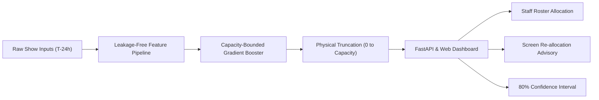

# Cinema Ticket Demand Forecasting

[](https://www.python.org/downloads/)
[](https://fastapi.tiangolo.com/)
[](https://scikit-learn.org/)
[](LICENSE)
[](tests/)

> **ALGIONS AI LABS — Advanced Individual Project Assessment**  
> **Role:** AI & Machine Learning Intern  
> **Domain:** Cinema Hall Ticket Booking  
> **Problem:** Capacity-Aware Show-Level Ticket Demand Forecasting & Staff Allocation  

---

## 🎯 Executive Overview

In cinema hall operations, optimizing auditorium allocation and scheduling concession, usher, and cleaning personnel requires accurate ticket demand forecasts **24 hours prior to showtime ($T-24\text{h}$)**. 

This repository delivers an end-to-end, reproducible ML decision-support system:
* **Prediction Unit:** Individual show screening event $(Screen, Showtime, Movie, Date)$.
* **Forecast Horizon:** $T-24\text{h}$ (strictly non-leaking pre-show information).
* **Target:** `tickets_sold` bounded strictly by physical `screen_capacity` ($0 \le \hat{y} \le \text{Capacity}$).
* **Modeling:** Benchmarked Naive Capacity Baseline vs. Ridge Regression vs. **Champion Gradient Boosted Trees**.
* **Results:** Test MAE of **6.44 tickets** and **9.33% WAPE** (an **82.3% error reduction** over baseline).
* **Interface:** Interactive Web Dashboard + REST API with confidence intervals, cold-start diagnostics, and staff roster recommendations.



---

## 📊 Benchmark Results on Held-Out Test Set (Chronological 15%)

Evaluated on **1,094 chronological held-out shows** (July 26, 2026 – August 31, 2026):

| Model Architecture | MAE (Tickets) | RMSE (Tickets) | WAPE (%) | Occupancy MAE (%) | Capacity Overrun (%) | Status |
| :--- | :---: | :---: | :---: | :---: | :---: | :---: |
| **Capacity-Adjusted Baseline** | 36.37 | 50.47 | 52.72% | 16.52% | 0.0% | Benchmarked |
| **Ridge Regression** | 7.51 | 11.06 | 10.89% | 3.46% | 0.0% | Benchmarked |
| **Gradient Boosting (Champion)** | **6.44** | **10.35** | **9.33%** | **2.80%** | **0.0%** | **Deployed Champion** |

### Cold-Start Diagnostic Performance
* **Cold-Start Shows (Days 0–3, $N=80$):** MAE = **7.62 tickets**, WAPE = **6.61%**.
* **Mature Releases (>3 Days, $N=1,014$):** MAE = **6.34 tickets**, WAPE = **9.71%**.

---

## 📁 Repository Structure

```text
Algions_Assignment/
├── .env.example                # Environment variables template
├── .gitignore                  # Git ignore rules
├── LICENSE                     # Open assessment license
├── README.md                   # Complete repository documentation
├── REPORT.md                   # Comprehensive technical evaluation report
├── DEMO_SCRIPT.md              # 3-5 minute video presentation script
├── requirements.txt            # Python dependencies
├── sample_request.json         # Ready-to-use API payload
├── data/
│   ├── cinema_shows_dataset.csv # 7,290 chronological show records
│   └── dataset_metadata.json   # Data dictionary & licensing metadata
├── artifacts/
│   ├── best_model.joblib       # Serialized champion model artifact
│   ├── model_metadata.json     # Training metadata & benchmark metrics
│   ├── feature_names.json      # Feature specifications
│   ├── actual_vs_predicted.png # Test set evaluation scatter plot
│   └── model_comparison_metrics.png # Comparative performance charts
├── notebooks/
│   └── cinema_demand_forecasting.ipynb # Complete EDA & modeling walkthrough
├── src/
│   ├── __init__.py
│   ├── config.py               # Constants, screen specs, staffing rules
│   ├── data_generator.py       # Reproducible synthetic data generation
│   ├── features.py             # Feature engineering & chronological splitter
│   ├── models.py               # Baseline, Ridge & Gradient Boosting wrappers
│   ├── train.py                # Chronological training & model export pipeline
│   ├── evaluate.py             # Slicing, error analysis & plot generation
│   ├── explain.py              # Explainability & operational decision advisory
│   └── api.py                  # FastAPI service & web dashboard server
├── static/
│   ├── index.html              # Responsive cinema manager dashboard UI
│   └── style.css               # Cinema dark-theme design
└── tests/
    ├── __init__.py
    ├── test_pipeline.py        # Dataset, leakage & capacity bounds tests
    └── test_api.py             # Endpoint tests, validation & batch inference
```

---

## ⚡ Quickstart Guide

### 1. Environment Setup
```bash
# Clone the repository
git clone https://github.com/your-username/cinema-demand-forecasting.git
cd cinema-demand-forecasting

# Create and activate virtual environment (optional but recommended)
python -m venv venv
# Windows:
.\venv\Scripts\activate
# Linux/macOS:
source venv/bin/activate

# Install required dependencies
pip install -r requirements.txt
```

### 2. Reproduce Dataset & Model Training
All components are fully automated and reproducible using fixed seeds (`RANDOM_SEED = 42`):

```bash
# 1. Generate the 7,290-show chronological dataset
python -m src.data_generator

# 2. Train baseline and candidate models, benchmark on test set, and save champion artifact
python -m src.train

# 3. Generate comprehensive error slicing and evaluation plots
python -m src.evaluate
```

### 3. Run Automated Tests
```bash
python -m pytest -v
```
All 9 unit and integration tests will execute:
* Dataset volume and capacity bounds checks
* Chronological split verification (zero future lookahead leakage)
* Capacity saturation bounds testing ($0 \le \hat{y} \le \text{Capacity}$)
* API endpoints (`/health`, `/metrics`, `/predict`, `/explain`, `/predict/batch`)

---

## 🚀 Running the Interactive Dashboard & API

Start the local server:
```bash
uvicorn src.api:app --reload --host 127.0.0.1 --port 8000
```

* **Interactive Web Dashboard:** Open [http://127.0.0.1:8000](http://127.0.0.1:8000) in your browser.
* **Interactive OpenAPI Swagger Docs:** Open [http://127.0.0.1:8000/docs](http://127.0.0.1:8000/docs).

### Dashboard Highlights:
* **Quick Presets:** Instantly test scenarios (e.g. *IMAX Opening Weekend*, *Midweek Indie Drama*, *Family Matinee*, *VIP Gold Night*).
* **Cold-Start Warning:** Live diagnostic badge when release age $\le 3$ days.
* **Operational Staffing Card:** Calculates required concession crew, ushers, and cleaners.
* **Screen Re-allocation Advisor:** Flags sellout risks on small screens or under-utilization on large screens.

---

## 🔌 API Usage Examples

### 1. Health Status
```bash
curl -X GET http://127.0.0.1:8000/health
```

### 2. Predict Show Demand (`POST /predict`)
```bash
curl -X POST http://127.0.0.1:8000/predict \
  -H "Content-Type: application/json" \
  -d @sample_request.json
```

**Response:**
```json
{
  "predicted_tickets": 284,
  "screen_capacity": 420,
  "predicted_occupancy_pct": 67.6,
  "confidence_interval_80": {
    "lower_bound": 271,
    "upper_bound": 297,
    "interval_width_tickets": 26
  },
  "is_cold_start": true,
  "cold_start_warning": "Cold-start: Theatrical run is day 1 (<= 3 days). Expect wider demand variance."
}
```

### 3. Full Decision-Support Advisory (`POST /explain`)
```bash
curl -X POST http://127.0.0.1:8000/explain \
  -H "Content-Type: application/json" \
  -d @sample_request.json
```

---

## 🛡️ Responsible AI & Operational Limitations

1. **Human-in-the-Loop:** Designed for **decision support**. Cinema managers retain final discretion over screen swaps and staffing rosters.
2. **Privacy:** Built entirely with non-PII, synthetic show-level transactional signals.
3. **Failure Modes:** Extreme weather disruptions, transit strikes, or sudden viral TikTok surges occurring between $T-24\text{h}$ and showtime require human manager override.

---

## 📜 License
This project and synthetic dataset are dedicated to the public domain under the **Creative Commons Zero (CC0)** / MIT Open License for assessment review.
